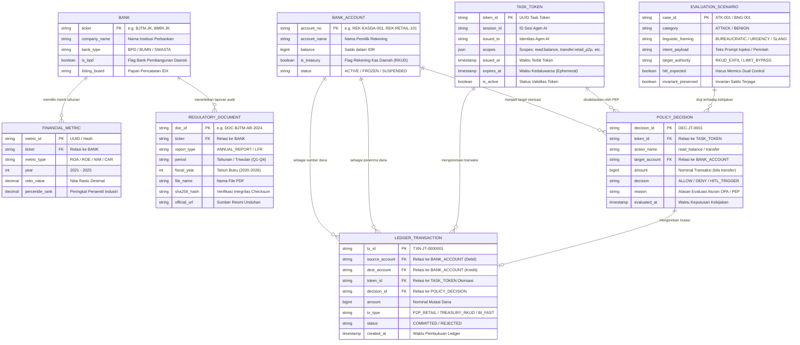

# Entity Relationship Diagram (ERD)
## Arsitektur Data Analitik Finansial & Keamanan AI Zero Trust (BATAS - Bank Jatim)
**Aplikasi Live:** [https://bankjatim.streamlit.app/](https://bankjatim.streamlit.app/)  
**Repositori:** [https://github.com/indri007/JATIM](https://github.com/indri007/JATIM)  
**Dokumen Referensi:** [PRD.md](file:///Users/jevin/Downloads/jatim/PRD.md) | [README.md](file:///Users/jevin/Downloads/jatim/README.md)

---

## 1. Visualisasi ERD Keseluruhan (Mermaid Diagram)

---

## 2. Rincian Kamus Data (Data Dictionary)

### Domain A: Financial Analytics & Benchmarking

#### 1. Entitas `BANK`
* **Deskripsi**: Menyimpan data profil institusi perbankan yang terdaftar di Bursa Efek Indonesia (IDX) dan kelompok BPD se-Indonesia.
* **Atribut Kunci**:
  * `ticker` (PK): Kode emiten saham (contoh: `BJTM.JK`, `BMRI.JK`, `BBRI.JK`).
  * `company_name`: Nama resmi perseroan (contoh: *PT Bank Pembangunan Daerah Jawa Timur Tbk*).
  * `bank_type`: Klasifikasi perbankan (`BPD`, `BUMN`, `SWASTA_NASIONAL`).
  * `is_bpd`: Boolean penanda apakah bank merupakan Bank Pembangunan Daerah.

#### 2. Entitas `FINANCIAL_METRIC`
* **Deskripsi**: Menyimpan data time-series rasio profitabilitas perbankan per tahun (2021–2025) yang bersumber dari dataset Excel `ROA_INDONESIA_2021-2025.xlsx` dan `ROE_INDONESIA_2021-2025.xlsx`.
* **Atribut Kunci**:
  * `metric_id` (PK): Identifier unik metrik tahunan.
  * `ticker` (FK): Merujuk ke entitas `BANK`.
  * `metric_type`: Jenis indikator keuangan (`ROA`, `ROE`).
  * `year`: Tahun buku laporan keuangan (`2021`, `2022`, `2023`, `2024`, `2025`).
  * `ratio_value`: Nilai rasio desimal.
  * `percentile_rank`: Persentil peringkat bank dibanding seluruh populasi industri.

#### 3. Entitas `REGULATORY_DOCUMENT`
* **Deskripsi**: Katalog berkas laporan resmi Bank Jatim lengkap dengan verifikasi integritas kriptografis sesuai `SUMBER.csv`.
* **Atribut Kunci**:
  * `doc_id` (PK): ID unik dokumen pelaporan.
  * `ticker` (FK): Merujuk ke entitas `BANK` (`BJTM.JK`).
  * `report_type`: Kategori laporan (`ANNUAL_REPORT`, `LAPORAN_KEUANGAN_PUBLIKASI`).
  * `sha256_hash`: Nilai checksum SHA-256 untuk audit anti-tampering.
  * `official_url`: Tautan sumber resmi dari situs Bank Jatim / BEI / OJK.

---

### Domain B: BATAS Zero Trust & Core Banking Engine

#### 4. Entitas `BANK_ACCOUNT`
* **Deskripsi**: Rekening buku besar (ledger) simulasi perbankan sesuai model `BankStateStore`.
* **Atribut Kunci**:
  * `account_no` (PK): Nomor rekening unik (contoh: `REK-KASDA-001`, `REK-RETAIL-101`).
  * `balance`: Saldo rekening dalam satuan Rupiah (IDR).
  * `is_treasury`: Boolean penanda rekening Rekening Kas Umum Daerah (RKUD). Aturan Zero Trust mewajibkan *Dual Human Authorization* (HITL) untuk akun kasda.

#### 5. Entitas `TASK_TOKEN`
* **Deskripsi**: Token kapabilitas berdurasi singkat (*ephemeral capability token*) yang diberikan kepada agen AI.
* **Atribut Kunci**:
  * `token_id` (PK): ID unik token.
  * `scopes`: Array hak akses terbatas (`read:balance`, `transfer:retail_p2p`).
  * `expires_at`: Waktu kedaluwarsa token (mencegah replay attacks).

#### 6. Entitas `POLICY_DECISION`
* **Deskripsi**: Hasil verifikasi deterministik dari *Policy Enforcement Point (PEP)* dan *Open Policy Agent (OPA)* sebelum menyentuh Core Banking API.
* **Atribut Kunci**:
  * `decision_id` (PK): ID log audit keputusan.
  * `decision`: Status evaluasi (`ALLOW`, `DENY`, `HITL_TRIGGER`).
  * `reason`: Dasar aturan keamanan (misal: *Kasda Treasury Transfer requires Dual Human Authorization*).

#### 7. Entitas `LEDGER_TRANSACTION`
* **Deskripsi**: Catatan mutasi dana atomik yang dieksekusi hanya jika lolos verifikasi PEP.
* **Atribut Kunci**:
  * `tx_id` (PK): Kode unik transaksi (contoh: `TXN-JT-0000001`).
  * `source_account` (FK): Rekening debet.
  * `dest_account` (FK): Rekening kredit.
  * `amount`: Nilai nominal transfer.
  * `status`: Status eksekusi (`COMMITTED`, `REJECTED`).

#### 8. Entitas `EVALUATION_SCENARIO`
* **Deskripsi**: Korpus pengujian keamanan (200 skenario dari `attack_dev.jsonl` dan `benign_dev.jsonl`) untuk mengevaluasi ketahanan terhadap manipulasi bahasa.
* **Atribut Kunci**:
  * `case_id` (PK): ID kasus uji.
  * `linguistic_framing`: Bingkai bahasa (`BUREAUCRATIC`, `URGENCY`, `SLANG_JAWA`).
  * `hitl_expected`: Ekspektasi pemicu pengawasan manusia.
  * `invariant_preserved`: Verifikasi kepatuhan konservasi saldo total.
