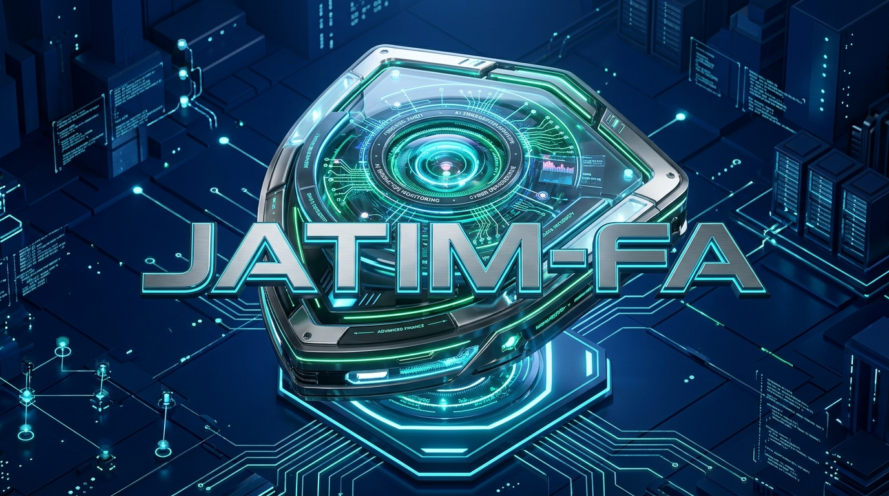
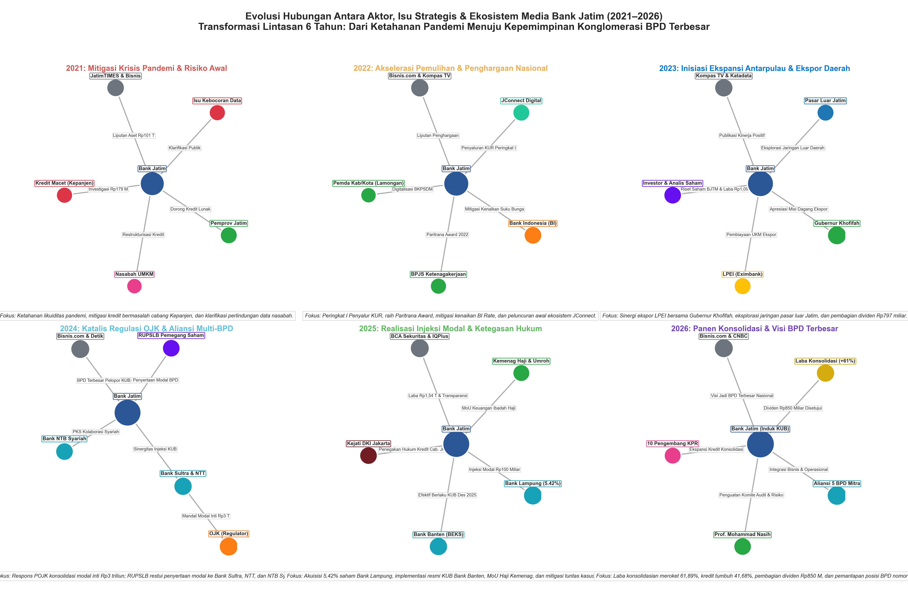

<p align="center">
  
</p>

# JATIM-FA: Jatim Audit Transaction Intelligence Monitor – Forensic Analytics
### *Enterprise Zero Trust Authority Boundary, Real-Time Transaction Intelligence & Court-Ready Forensic Analytics for Bank Jatim*

<p align="center">
  <a href="https://github.com/indri007/JATIM/actions/workflows/ci.yml"></a>
  <a href="https://bankjatim.streamlit.app/"></a>
  <a href="https://www.openpolicyagent.org/"></a>
  <a href="https://www.python.org/"></a>
  <a href="tests/"></a>
  <a href="LICENSE"></a>
  
</p>

---

**JATIM-FA** (**Jatim Audit Transaction Intelligence Monitor – Forensic Analytics**) adalah platform pemantauan transaksi cerdas, penegakan batas wewenang **Zero Trust (BATAS)**, dan investigasi forensik digital komprehensif yang dirancang untuk **PT Bank Pembangunan Daerah Jawa Timur Tbk (IDX: BJTM)**. 

Platform ini menggabungkan mesin penegakan kebijakan deterministik (*Open Policy Agent*), telemetri log anti-manipulasi (*Promtail $\rightarrow$ Grafana Loki*), analitik jaringan wacana media (*NodeXL*), serta instrumen evaluasi kepuasan auditor internal (*System Usability Scale*).

* 🌐 **Live Demo Portal:** [https://bankjatim.streamlit.app/](https://bankjatim.streamlit.app/)  
* 📂 **Repositori Resmi:** [https://github.com/indri007/JATIM](https://github.com/indri007/JATIM)  
* 👩‍💻 **Peneliti & Pengembang:** Indri Anjar Kartika Sari  
* 🏛️ **Afiliasi:** IDS Digital College (STMIK Indo Daya Suvana) · UPN "Veteran" Jawa Timur · Purwadhika Digital Technology School

---

## 🏛️ Arsitektur Inti: Dari "Intent Detection" ke "Authority Boundary"

Pendekatan keamanan AI konvensional yang hanya menyaring teks (*intent detection*) terbukti rapuh terhadap teknik *jailbreaking* dan *indirect prompt injection*. **JATIM-FA** menerapkan paradigma **Zero Trust (NIST SP 800-207)**:

```
┌─────────────────────────────────────────────────────────────────────────────┐
│                          JATIM-FA SYSTEM ARCHITECTURE                       │
└─────────────────────────────────────────────────────────────────────────────┘
  [ Ingress Nasabah / Transaksi API / LLM Agent ]
                         │
                         ▼
  ┌─────────────────────────────────────────────────────────┐
  │ 1. POLICY ENFORCEMENT POINT (BATAS PEP)                 │
  │    • Verifikasi Ephemeral Task Token (HMAC/Ed25519)     │
  │    • Validasi Least-Privilege Scopes (read/transfer)    │
  │    • Pengecekan Masa Berlaku (Anti-Replay TTL)          │
  └────────────────────────┬────────────────────────────────┘
                           │
                           ▼
  ┌─────────────────────────────────────────────────────────┐
  │ 2. DETERMINISTIC POLICY ENGINE (OPA / REGO)             │
  │    • Default Deny Invariant                             │
  │    • Threshold Stepping: Nominal > Rp10 Juta ──> HITL   │
  │    • Rekening Kas Daerah (REK-KASDA) ──> DUAL-CONTROL   │
  └───────────────┬─────────────────────────┬───────────────┘
                  │ (Approved)              │ (Denied / Logged)
                  ▼                         ▼
  ┌──────────────────────────────┐  ┌────────────────────────────────────────┐
  │ 3. CORE BANKING EXECUTION    │  │ 4. IMMUTABLE FORENSIC LOGS (LOKI)      │
  │    • Ledger Invariant Saldo  │  │    • Nanosecond Tamper-Proof Audit     │
  │    • BI-FAST & Settlement    │  │    • Hash Chaining (POJK 11/2022)      │
  └──────────────────────────────┘  └────────────────────────────────────────┘
```

---

## ✨ Fitur & Modul Utama JATIM-FA

### 1. 🛡️ BATAS Zero Trust Engine (OPA / Rego)
* **Default Deny:** Seluruh aksi agen AI diblokir secara bawaan kecuali memiliki izin token yang valid.
* **Proteksi Rekening Kas Daerah (PADK OJK No. 1/2026):** Rekening Kasda (`REK-KASDA`) dilarang diproses otonom dan mewajibkan otorisasi ganda (*Dual-Control Maker-Checker*).
* **ASR 0.00%:** Mengeliminasi keberhasilan serangan manipulasi prompt hingga 0% dengan Wilson 95% Confidence Interval.

### 2. 🔍 Forensik Digital & Observabilitas SOC (Grafana + Loki + Prometheus)
* **Live Log Streaming:** Pemantauan real-time log penolakan OPA dan deteksi anomali via *LogQL*.
* **Dual Dashboards:** Dashboard Eksekutif Kepatuhan OJK dan Dashboard Tim SOC / Forensik Siber.
* **Kepatuhan Audit:** Tabel PostgreSQL otomatis memetakan kontrol regulasi **POJK 11/POJK.03/2022** dan **PADK OJK 1/2026**.

### 3. 🕸️ Analisis Jaringan Wacana Media (NodeXL Empiris 2021–2026)
* Analisis komprehensif terhadap **174 artikel berita terverifikasi** kurun waktu 5 tahun.
* Pemetaan 20 topik utama, pemodelan kuadran pengaruh (*Degree vs Betweenness Centrality*), dan evolusi 6 era relasi aktor.

<p align="center">
  
  <br><em>Gambar: Evolusi Hubungan Antara Aktor, Isu Strategis & Ekosistem Media Bank Jatim (2021–2026)</em>
</p>

### 4. 📋 Evaluasi Pengalaman Pengguna (*Usability Testing Workbook*)
* Buku kerja interaktif [Uji_Pengalaman_Pengguna_BankJatim_FINAL.xlsx](file:///Users/jevin/Downloads/jatim/Uji_Pengalaman_Pengguna_BankJatim_FINAL.xlsx) untuk 3 auditor forensik internal (*Reza, Agus, Yudis*).
* Memuat 5 skenario tugas investigasi (T1–T5), kalkulator otomatis **System Usability Scale (SUS)**, dan formulir [Informed Consent](file:///Users/jevin/Downloads/jatim/LEMBAR_PERSETUJUAN_PARTISIPAN.md).

---

## 📂 Struktur Repositori

```text
├── .github/workflows/ci.yml                  # Pipeline Otomasi CI/CD (19 Tests + OPA + Security)
├── docs/assets/
│   ├── jatim_fa_logo_3d.png                  # Master 3D Logo Banner JATIM-FA
│   └── jatim_fa_logo_3d.jpg
│
├── BATAS/                                    # Paket Inti Riset & Engine Zero Trust
│   ├── policies/                             # Aturan Otorisasi OPA (Open Policy Agent)
│   │   ├── authorization.rego                # Kebijakan Rego (Proteksi Kasda, Limit Retail)
│   │   └── authorization_test.rego           # Unit test kebijakan Rego (100% PASS)
│   ├── testbed/                              # Simulator Core Banking API & State Store
│   ├── dataset/                              # 200 Kasus Uji Skenario Injeksi & Normal
│   └── tests/                                # Pytest Automated Test Suite
│
├── dashboards/                               # Stack Observabilitas SOC Produksi
│   ├── README.md                             # Panduan Operasional & Kueri Forensik LogQL
│   ├── docker-compose.yml                    # Orkestrasi 7 Kontainer (Grafana, Loki, Prometheus, Postgres)
│   ├── grafana/                              # Model JSON Dashboard Eksekutif & SOC
│   ├── loki/ & promtail/                     # Infrastruktur Pengumpulan Log Audit Forensik
│   └── postgres/init_compliance.sql          # Skema Database Kepatuhan Regulasi OJK
│
├── tests/                                    # Paket Unit Test Tingkat Sistem
│   ├── test_news_dataset.py                  # Audit Integritas 174 Berita Bank Jatim
│   ├── test_nodexl_graph.py                  # Validasi Metrik Grafika NodeXL
│   ├── test_usability_workbook.py            # Validasi Formula Workbook Evaluasi SUS
│   └── test_streamlit_app.py                 # Pengujian Kompilasi Dashboard Master
│
├── streamlit_app.py                          # Aplikasi Web Master Portal Bank Jatim
├── buat_workbook_uji.py                      # Generator Workbook Evaluasi Pengguna
├── kumpul_berita_bankjatim.py                # Skrip Crawler Berita 5 Tahun (Google News & YouTube)
├── generate_nodexl_analysis.py               # Generator 5 Gambar Grafik NodeXL & Workbook Excel
├── generate_annual_relational_network.py     # Generator Visualisasi Peta Relasi 6 Era
├── Berita Bank Jatim 2021–2026 - Berita.csv  # Dataset Empiris Berita Terverifikasi
├── nodexl_bankjatim_network.xlsx             # Buku Kerja Graf NodeXL Siap-Impor
├── Uji_Pengalaman_Pengguna_BankJatim_FINAL.xlsx # Workbook Evaluasi Auditor Forensik
└── LEMBAR_PERSETUJUAN_PARTISIPAN.md          # Dokumen Etika Riset Informed Consent
```

---

## 🚀 Panduan Memulai Cepat (Quick Start)

### 1. Kloning Repositori & Menjalankan Pengujian Unit
```bash
git clone https://github.com/indri007/JATIM.git
cd JATIM

# 1. Jalankan seluruh 19 unit test secara serentak
python3 -m pytest -c pytest.ini tests/ BATAS/tests/ -v

# 2. Uji kebijakan OPA Zero Trust
cd BATAS && opa test policies/ -v
```

### 2. Menjalankan Dashboard Master Streamlit (Lokal)
```bash
cd /Users/jevin/Downloads/jatim
pip install -r requirements.txt
streamlit run streamlit_app.py
```
Akses di browser Anda: **`http://localhost:8501`** (atau demo publik di [https://bankjatim.streamlit.app/](https://bankjatim.streamlit.app/)).

### 3. Menjalankan Stack Observabilitas SOC (Grafana + Loki)
```bash
cd dashboards
docker compose up -d
```
* **Grafana Dashboard**: `http://localhost:3000` *(User: `admin` / Password: `batas2026`)*
* **Prometheus Telemetri**: `http://localhost:9090`
* **Loki Log Engine**: `http://localhost:3100`

---

## 📊 Hasil Kinerja Finansial & Evaluasi Keamanan

### 1. Profil Finansial Bank Jatim (IDX: BJTM 2021–2026)
* **Laba Konsolidasi Kuartal 2026**: Melonjak **`+61,89%`** didorong sinergi aliansi KUB multi-BPD.
* **Pertumbuhan Penyaluran Kredit**: Meningkat **`+41,68%`** mencapai portofolio Rp59,6 triliun.
* **Dividen RUPST 2026**: Disetujui pembagian dividen tunai sebesar **`Rp850 Miliar`**.
* **ROA & ROE Multi-Tahun**: Rata-rata ROA 5 tahun sebesar `1.78%` (Kategori Sehat) dan ROE `15.32%` (Peringkat Top 21% emiten perbankan nasional).

### 2. Evaluasi Pertahanan AI BATAS
* **Attack Success Rate (ASR)**: **`0.00%`** (vs Baseline Vanilla LLM: `72.5%`).
* **Overhead Latensi**: Rata-rata **`78.43 ms`** (sangat efisien untuk *core banking real-time*).
* **Konservasi Invarian Dana**: $\sum \Delta \text{Balance} = 0$ (*Zero Fund Leakage* pada seluruh skenario serangan).

---

## 📖 Sitasi Akademis (Citation)

Apabila Anda menggunakan platform, instrumen uji, dataset, atau kebijakan keamanan **JATIM-FA / BATAS** ini dalam penelitian ilmiah Anda, silakan mencantumkan sitasi berikut:

```bibtex
@misc{jatim_fa_2026,
  title  = {JATIM-FA: Jatim Audit Transaction Intelligence Monitor – Forensic Analytics and Zero Trust Authority Boundary for Agentic AI in Regional Banking},
  author = {Indri Anjar Kartika Sari and contributors},
  year   = {2026},
  url    = {https://github.com/indri007/JATIM}
}
```

---

## 📜 Lisensi & Etika Data
* Perangkat lunak ini dirilis di bawah lisensi **[MIT License](LICENSE)**.
* Dataset wacana berita dan instrumen uji berlisensi **Creative Commons Attribution 4.0 International (CC BY 4.0)**.
* Seluruh data transaksi akun pada simulasi testbed menggunakan data sintetis untuk mematuhi ketentuan kerahasiaan perbankan dan **UU No. 27/2022 (Perlindungan Data Pribadi)**.
