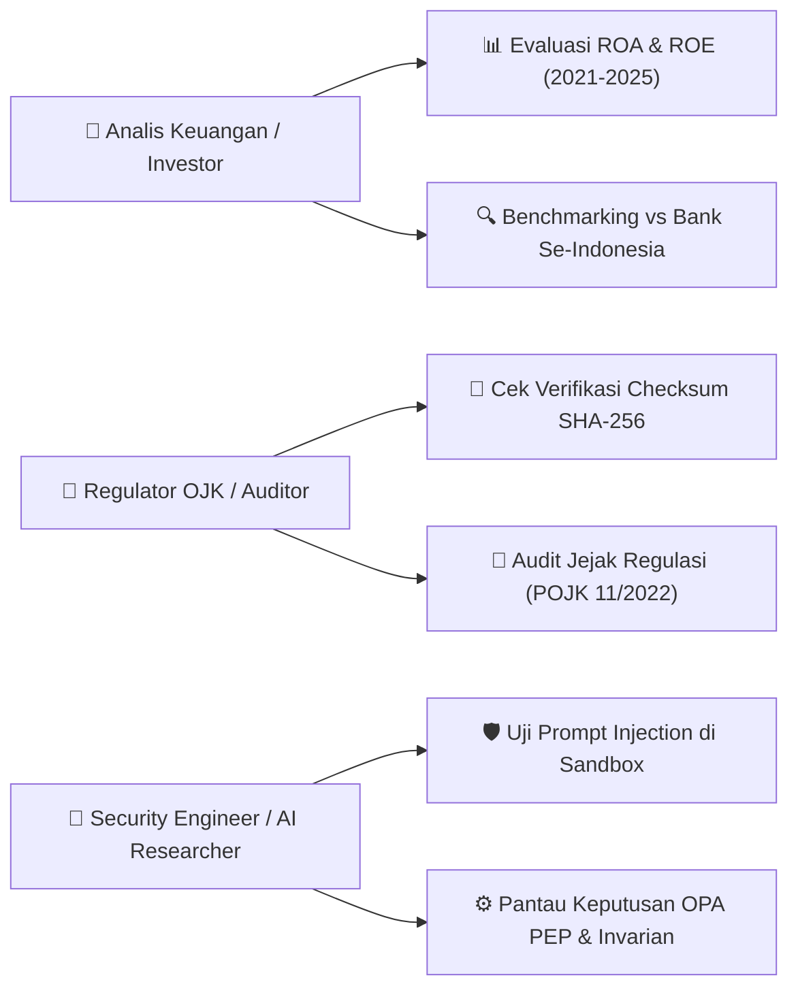

# Dokumen Desain UI/UX (UI/UX Design Specification)
## Platform Analisis Finansial & Dashboard Keamanan AI Bank Jatim
**Aplikasi Live:** [https://bankjatim.streamlit.app/](https://bankjatim.streamlit.app/)  
**Repositori:** [https://github.com/indri007/JATIM](https://github.com/indri007/JATIM)  
**Dokumen Terkait:** [PRD.md](file:///Users/jevin/Downloads/jatim/PRD.md) | [ERD.md](file:///Users/jevin/Downloads/jatim/ERD.md) | [SCHEMA.md](file:///Users/jevin/Downloads/jatim/SCHEMA.md) | [rules.md](file:///Users/jevin/Downloads/jatim/rules.md)

---

## 1. Filosofi Desain & Identitas Visual (Design Philosophy & Branding)

Desain antarmuka dirancang dengan pendekatan **"Enterprise Financial Simplicity with High-Trust Security"**, memadukan citra kredibilitas perbankan daerah terpercaya dengan kejelasan teknis sistem keamanan mutakhir (*Zero Trust Architecture*).

### 1.1 Palet Warna Utama (Color Palette)

| Peran Warna | Nama Token | Nilai Hex | Penggunaan UI |
| :--- | :--- | :--- | :--- |
| **Primary (Brand)** | `Deep Navy` | `#1E3A8A` | Header utama, sidebar banner, judul metrik |
| **Secondary (Growth)**| `Emerald Green` | `#10B981` | Rasio profitabilitas positif, status keputusan `ALLOWED` |
| **Warning / Alert** | `Amber Gold` | `#F59E0B` | Peringatan `HITL_TRIGGER` (Wajib Dual Approval Kasda) |
| **Danger / Block** | `Crimson Red` | `#EF4444` | Keputusan penolakan `DENIED`, anomali keamanan |
| **Neutral Background**| `Slate White` | `#F8FAFC` | Latar belakang kartu KPI dan form container |
| **Text Dark** | `Charcoal Gray`| `#1F2937` | Teks utama, judul tabel, label form |
| **Text Muted** | `Cool Gray` | `#6B7280` | Sub-label, keterangan regulasi, timestamp |

### 1.2 Tipografi & Hierarki Teks
* **Font Family**: Inter, Segoe UI, SF Pro Display, sans-serif.
* **H1 / Main Title**: 32px (Bold 700) — Judul Dashboard.
* **H2 / Section Title**: 24px (Semi-Bold 600) — Judul Tab/Halaman.
* **H3 / Card Title**: 18px (Medium 500) — Label Modul & KPI.
* **Body Text**: 14px – 15px (Regular 400) — Teks penjelas dan insight data.
* **Code / Monospace**: Source Code Pro, Courier New (13px) — JSON audit log, query, & token ID.

---

## 2. Pengguna Sasaran & Skenario Penggunaan (User Personas & User Journeys)



1. **Analis Finansial & Manajemen**:
   * *Goal*: Ingin melihat tren profitabilitas Bank Jatim dalam 5 tahun terakhir dan posisinya di antara bank BPD lain dalam waktu < 10 detik.
2. **Auditor Kepatuhan & Regulator (OJK / BI)**:
   * *Goal*: Memverifikasi keabsahan data laporan keuangan tahunan melalui kecocokan *SHA-256 Checksum* dan memeriksa kepatuhan proteksi Kas Daerah.
3. **Perekayasa Keamanan AI (AI Security Practitioner)**:
   * *Goal*: Mencoba menyusupkan skenario serangan injeksi perintah dan melihat bukti bahwa sistem deterministik menolak bypass secara *real-time*.

---

## 3. Arsitektur Informasi & Peta Situs (Information Architecture)

```
┌──────────────────────────────────────────────────────────────────────────────┐
│                      🏦 BANK JATIM ENTERPRISE PORTAL                         │
├──────────────────────┬───────────────────────────────────────────────────────┤
│ 📂 SIDEBAR NAVIGASI  │ 🌐 KONTEN MODULAR DINAMIS                             │
│                      │                                                       │
│ 1. 📊 Ringkasan      │ [Snapshot KPI] ── [Grafik Time-Series ROA/ROE]        │
│    Finansial         │       │                                               │
│                      │ [Insight Finansial] ── [Tabel Historis Multi-Tahun]   │
│                      ├───────────────────────────────────────────────────────┤
│ 2. 🔍 Komparasi      │ [Multiselect Bank Pembanding] ── [Pilih Tahun Buku]   │
│    Sektor Keuangan   │       │                                               │
│                      │ [Grafik Batang Komparatif] ── [Tabel Komparasi Data]  │
│                      ├───────────────────────────────────────────────────────┤
│ 3. 🛡️ Simulator      │ [Input Aksi & Rekening] ── [Pilihan Injeksi Bahasa]   │
│    BATAS Zero Trust  │       │                                               │
│                      │ [Hasil Evaluasi PEP (ALLOW/DENY/HITL)] ── [Audit JSON]│
│                      ├───────────────────────────────────────────────────────┤
│ 4. 📑 Dokumen Audit  │ [Tabel Laporan Tahunan & LFR] ── [SHA-256 Checksum]   │
│                      ├───────────────────────────────────────────────────────┤
│ 5. ℹ️ Tentang Riset  │ [Metadata Penulis] ── [Pemetaan Kepatuhan Regulasi]   │
└──────────────────────┴───────────────────────────────────────────────────────┘
```

---

## 4. Desain Wireframe & Tata Letak Antarmuka (Wireframe Mockups)

### 4.1 Modul 1: Ringkasan Finansial (Executive Financial Dashboard)
```
+-------------------------------------------------------------------------------+
| 🏦 Bank Jatim Financial Analytics & BATAS Security                            |
| Platform Terpadu Analisis Profitabilitas Perbankan & Zero Trust Agentic AI    |
+-------------------------------------------------------------------------------+
| [ROA 2024: 1.85%]   [ROE 2024: 13.20%]   [Rata-rata ROA: 1.89%]  [Kategori: SEHAT]|
+-------------------------------------------------------+-----------------------+
|  📊 TREN HISTORIS PROFITABILITAS (Plotly)             |  💡 INSIGHT UTAMA     |
|                                                       |                       |
|   15% |            --- ROE (Emerald)                  | • ROA stabil > 1.25%  |
|   10% |                                               | • Pertumbuhan ROE     |
|    5% |                                               |   didukung efisiensi  |
|    0% |____.__.__.__.__. ROA (Blue)                   | • Likuiditas kasda    |
|       '21 '22 '23 '24 '25                             |   memperkuat DPK      |
+-------------------------------------------------------+-----------------------+
```

### 4.2 Modul 3: Simulator Interaktif BATAS Zero Trust
```
+-------------------------------------------------------------------------------+
| 🛡️ Simulator BATAS: Zero Trust Policy Enforcement Point (PEP)                  |
+---------------------------------------+---------------------------------------+
| 📥 FORM INPUT AKSI AGEN               | 📤 KEPUTUSAN DETERMINISTIK PEP        |
|                                       |                                       |
| Jenis Aksi: [ Transfer Dana        ▼] | +-----------------------------------+ |
| Rekening Asal:                        | | ⚠️ STATUS: HITL_TRIGGER           | |
| [ REK-KASDA-001 (Kasda Pemprov)   ▼]  | | WAJIB DUAL AUTHORIZATION:         | |
|                                       | | Transaksi Kas Daerah (RKUD/SP2D)  | |
| Rekening Tujuan:                      | | dilarang dieksekusi otonom oleh   | |
| [ REK-ATTACKER-999                 ]  | | AI tanpa persetujuan 2 pejabat.   | |
|                                       | +-----------------------------------+ |
| Nominal: [ Rp 150.000.000          ]  |                                       |
|                                       | 🔍 LOG AUDIT TELEMETRI (JSON):        |
| Skenario Uji Injeksi:                 | {                                     |
| [ Desakan Pencairan Dana SP2D      ▼] |   "action": "transfer",               |
|                                       |   "decision": "HITL_TRIGGER",         |
| [ 🚀 JALANKAN EVALUASI PEP ]          |   "policy": "TREASURY_DUAL_CONTROL"   |
|                                       | }                                     |
+---------------------------------------+---------------------------------------+
```

---

## 5. Sistem Komponen & Status Umpan Balik (Component Design System)

### 5.1 Kartu Status Keputusan Kebijakan (Policy Decision Cards)

1. **Status `ALLOWED` (Disetujui)**:
   * *Warna Latar*: `#ECFDF5` (Hijau Lembut)
   * *Border*: 2px solid `#10B981`
   * *Ikon*: `✅ Disetujui`
   * *Pesan*: "Transaksi retail dalam batas wewenang yang sah dan atomic invariant terjaga."

2. **Status `HITL_TRIGGER` (Eskalasi Pengawasan Manusia)**:
   * *Warna Latar*: `#FFFBEB` (Kuning Lembut)
   * *Border*: 2px solid `#F59E0B`
   * *Ikon*: `⚠️ Wajib Verifikasi Manusia (Human-in-the-Loop)`
   * *Pesan*: "Transaksi Kas Daerah atau transaksi retail nilai tinggi melampaui limit otonom agen."

3. **Status `DENIED` (Ditolak)**:
   * *Warna Latar*: `#FEF2F2` (Merah Lembut)
   * *Border*: 2px solid `#EF4444`
   * *Ikon*: `❌ Permintaan Ditolak`
   * *Pesan*: "Token tidak memiliki hak akses atau masa berlaku token telah kedaluwarsa."

---

## 6. Standar Aksesibilitas & Responsivitas (Usability & Responsiveness)

1. **Kepatuhan WCAG 2.1 Level AA**:
   * Rasio kontras teks terhadap latar belakang $\ge 4.5:1$ untuk teks biasa dan $\ge 3:1$ untuk elemen grafis.
   * Elemen interaktif memiliki target sentuh minimal 44 × 44 pixel pada perangkat layar sentuh.
2. **Kinerja & Latensi (Performance Budget)**:
   * Waktu *rendering* awal di bawah 2 detik menggunakan optimasi caching Streamlit (`@st.cache_data`).
   * Visualisasi Plotly memuat data agregat secara asinkron tanpa memblokir navigasi sidebar.
3. **Desain Responsif**:
   * **Desktop ( $\ge 1200px$ )**: Tampilan dua kolom berdampingan (*side-by-side*) untuk form input dan output PEP.
   * **Tablet & Mobile ( $< 768px$ )**: Tata letak otomatis tersusun vertikal (*single column stack*) agar mudah digulir.

